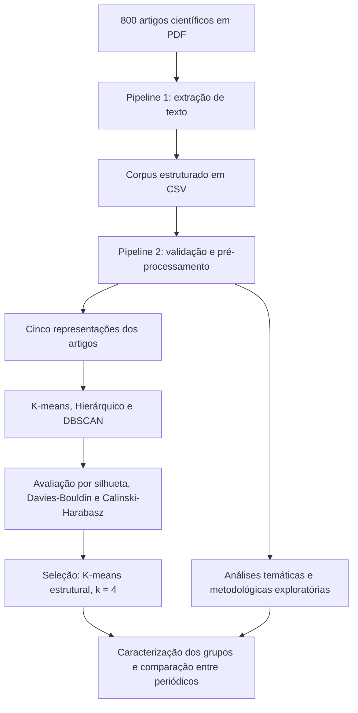

# Modelo Computacional para Identificação e Caracterização de Perfis de Escrita em Periódicos Científicos de Computação

Projeto desenvolvido no âmbito de uma dissertação de **Mestrado em Ciência da Computação**, na Universidade Tecnológica Federal do Paraná (UTFPR), com o objetivo de investigar padrões recorrentes em artigos científicos por meio de **Processamento de Linguagem Natural (PLN)** e **Aprendizado de Máquina Não Supervisionado**.

A pesquisa propõe um processo computacional para extrair, representar, agrupar e caracterizar artigos publicados em diferentes periódicos da área da Computação, considerando características lexicais, semânticas e estruturais. A análise busca identificar similaridades e diferenças entre os documentos e investigar como os agrupamentos se distribuem entre os periódicos.

## Objetivo

Propor e avaliar um modelo computacional baseado em PLN capaz de identificar padrões recorrentes nos artigos e caracterizar perfis de publicação em periódicos científicos da área da Computação.

Os objetivos específicos incluem sistematizar um processo reprodutível de análise textual, comparar representações e algoritmos de agrupamento e interpretar os perfis identificados em relação às características dos documentos e aos periódicos de origem.

## Corpus de pesquisa

O corpus é composto por **800 artigos científicos**, selecionados por **amostragem não probabilística baseada na recência**, com 100 documentos de cada um dos oito periódicos. A seleção considerou periódicos classificados no estrato **A1 do Qualis CAPES (quadriênio 2021–2024)**, na área de Computação. Os artigos selecionados foram publicados entre **2024 e 2026**.

| Periódico | Artigos |
|---|---:|
| ACM Computing Surveys | 100 |
| Computer Science Review | 100 |
| Education and Information Technologies | 100 |
| ICT Express | 100 |
| IEEE Communications Surveys and Tutorials | 100 |
| Information Sciences | 100 |
| ISA Transactions | 100 |
| Proceedings of the IEEE | 100 |
| **Total** | **800** |

### Distribuição por ano

| Ano | Artigos | Percentual |
|---:|---:|---:|
| 2024 | 157 | 19,63% |
| 2025 | 593 | 74,13% |
| 2026 | 50 | 6,25% |
| **Total** | **800** | **100%** |

*Os percentuais são arredondados e podem apresentar pequena diferença na soma.*

## Metodologia

A pesquisa foi organizada em três fases: **descritiva**, dedicada à revisão da literatura; **experimental**, voltada à construção do corpus e ao desenvolvimento do modelo; e **analítica**, destinada à avaliação e interpretação dos agrupamentos.

O processamento computacional foi estruturado em dois pipelines, implementados em **Python** e executados no **Google Colab**, com integração ao **Google Drive**.

### Pipeline 1 — Extração textual

- Organização dos arquivos PDF em pastas por periódico.
- Localização recursiva dos documentos no Google Drive.
- Extração do texto de cada página com `PyPDF2`.
- Processamento paralelo por meio de `ThreadPoolExecutor`.
- Registro do caminho do arquivo, do conteúdo extraído e do status de processamento.
- Consolidação dos dados em formato CSV para utilização no segundo pipeline.

### Pipeline 2 — Pré-processamento e análise

1. **Carregamento e validação:** leitura do CSV, exclusão de registros inválidos ou duplicados e identificação do periódico e do ano de publicação.
2. **Limpeza textual:** remoção de referências bibliográficas, identificadores, metadados editoriais, URLs, citações numéricas e outros ruídos da extração dos PDFs.
3. **Pré-processamento por representação:** normalização, tokenização, remoção de *stopwords* e lematização para BoW e TF-IDF; preservação mais ampla da estrutura linguística para *embeddings*.
4. **Representação vetorial:** construção de cinco conjuntos de atributos dos documentos.
5. **Agrupamento:** aplicação e comparação de K-means, Agrupamento Hierárquico e DBSCAN.
6. **Avaliação e interpretação:** seleção dos agrupamentos, análise de indicadores estruturais e descrição temática e metodológica dos grupos.

## Representações dos artigos

| Representação | Características | Dimensões |
|---|---|---:|
| Bag of Words (BoW) | Frequência de termos | 6.000 |
| TF-IDF | Relevância dos termos no corpus | 6.000 |
| Embeddings contextuais | Representação semântica com `all-MiniLM-L6-v2` | 384 |
| Estrutural | Indicadores da organização documental | 17 |
| Híbrida | Concatenação de embeddings e indicadores estruturais | 401 |

As representações BoW e TF-IDF utilizaram vocabulário limitado a 6.000 atributos. Para os *embeddings*, os textos foram divididos em segmentos de aproximadamente 250 palavras, com até 16 segmentos por artigo, posteriormente agregados em um único vetor. Os indicadores estruturais incluem características como extensão do texto, quantidade de figuras, tabelas, equações e densidade de citações e elementos numéricos.

## Agrupamento e avaliação

Foram avaliados os algoritmos **K-means**, **Agrupamento Hierárquico** e **DBSCAN**, considerando diferentes configurações e parâmetros. A métrica principal foi o **coeficiente de silhueta**, calculado com distância de cosseno, complementado pelos índices **Davies-Bouldin** e **Calinski-Harabasz**. Para a representação estrutural com K-means, a análise da **inércia pelo método do cotovelo** auxiliou na escolha do número final de grupos.

### Melhores resultados por representação

| Representação | Algoritmo | Grupos | Silhueta |
|---|---|---:|---:|
| Estrutural | K-means | 10 | **0,3357** |
| Híbrida | K-means | 4 | 0,2271 |
| Embeddings | K-means | 5 | 0,2151 |
| TF-IDF | Hierárquico | 2 | 0,1035 |
| BoW | K-means | 5 | 0,0980 |

Embora a maior silhueta tenha sido obtida com **10 grupos**, a configuração final selecionada foi **K-means sobre os indicadores estruturais com 4 grupos**, pois apresentou silhueta muito próxima (**0,3350**) e uma região de inflexão da inércia próxima de `k = 4`.

**Métricas da configuração final:** silhueta = **0,3350**; Davies-Bouldin = **1,7352**; Calinski-Harabasz = **164,21**; cobertura = **100% dos 800 artigos**.

## Perfis estruturais identificados

| Grupo | Artigos | Percentual | Caracterização predominante |
|---:|---:|---:|---|
| 0 | 220 | 27,5% | Extensão intermediária; presença de tabelas e vocabulário associado, em parte, à educação. |
| 1 | 172 | 21,5% | Artigos mais curtos e menor quantidade de figuras. |
| 2 | 208 | 26,0% | Artigos mais extensos, com maior número de figuras e maior densidade de citações. |
| 3 | 200 | 25,0% | Maior densidade de elementos numéricos e maior presença mediana de equações. |

Entre os resultados observados, **97%** dos artigos de *ACM Computing Surveys* e **90%** dos artigos de *Education and Information Technologies* foram atribuídos ao grupo 0. O grupo 2 concentrou **92,63%** dos artigos de *IEEE Communications Surveys and Tutorials*, enquanto o grupo 3 reuniu **71%** dos artigos de *Information Sciences* e **65%** dos artigos de *ISA Transactions*.

## Análises exploratórias complementares

A pesquisa também utilizou informações **não empregadas diretamente na formação dos agrupamentos finais**, mas relevantes para sua interpretação:

- **Palavras-chave dos autores:** identificadas em 781 artigos; maior recorrência de `machine learning`, `deep learning` e `artificial intelligence`.
- **Similaridade temática:** análise de Jaccard entre conjuntos de palavras-chave dos periódicos e identificação de famílias temáticas em resumos com expressões regulares.
- **Perfis metodológicos indicativos:** comparação semântica com descrições prototípicas das categorias teórico, qualitativo, quantitativo, experimental e revisão. A categoria experimental foi a mais frequente, com 433 artigos.
- **Termos representativos:** uso de TF-IDF para apoiar a caracterização lexical dos agrupamentos.
- **Unidades textuais:** comparação exploratória de *embeddings* produzidos a partir de textos completos, resumos e introduções, com diferentes quantidades de documentos disponíveis em cada análise.

## Tecnologias utilizadas

- **Linguagem e ambiente:** Python, Google Colab e Google Drive.
- **Extração e manipulação:** PyPDF2, pandas e `concurrent.futures`.
- **Processamento textual:** NLTK e expressões regulares.
- **Representação e agrupamento:** scikit-learn e Sentence Transformers (`all-MiniLM-L6-v2`).
- **Análise e visualização:** NumPy e Matplotlib.

## Reprodução da pesquisa

1. Organize os PDFs dos artigos em diretórios separados por periódico.
2. Execute o **Pipeline 1** para extrair os textos e gerar o corpus tabular em CSV.
3. Disponibilize o CSV ao **Pipeline 2** e realize a validação e o pré-processamento.
4. Gere as cinco representações dos artigos e execute os algoritmos de agrupamento.
5. Compare as métricas, selecione a configuração estrutural com `k = 4` e examine os perfis e sua distribuição por periódico.

A reprodução exata dos resultados exige a mesma seleção de artigos e os mesmos parâmetros de processamento e agrupamento utilizados na execução da dissertação. Os notebooks e os arquivos de entrada devem ser consultados para verificar os caminhos e as configurações específicas do ambiente.

## Limitações e interpretação

**Os quatro grupos identificados representam predominantemente perfis estruturais de publicação, e não uma comprovação de estilos linguísticos ou discursivos distintos.** Características como extensão, figuras, equações e citações também podem refletir diferenças temáticas, metodológicas e editoriais.

Além disso, a pesquisa foi delimitada a oito periódicos e depende de procedimentos automáticos de extração textual de arquivos PDF, sujeitos a variações de formatação. As métricas internas avaliam os agrupamentos no espaço de atributos escolhido, mas não substituem uma validação externa ou uma análise linguística detalhada.

Como continuidade, propõe-se ampliar o corpus, aperfeiçoar a extração e a validação das características documentais e aprofundar a comparação entre diferentes seções textuais dos artigos.

## Autoria

**Gabriel Evaristo Santana da Silva**  
Mestrado em Ciência da Computação — Universidade Tecnológica Federal do Paraná (UTFPR)  
**Orientador:** Prof. Dr. Ionildo José Sanches  
**Ano:** 2026

**Título da dissertação:** *Modelo Computacional Baseado em Processamento de Linguagem Natural para Identificação e Caracterização de Perfis de Escrita em Periódicos Científicos da Área da Computação*.
